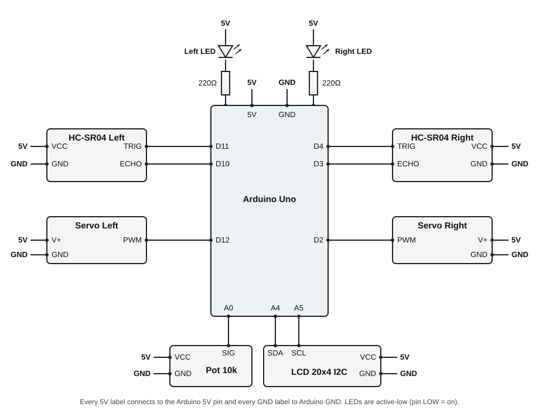
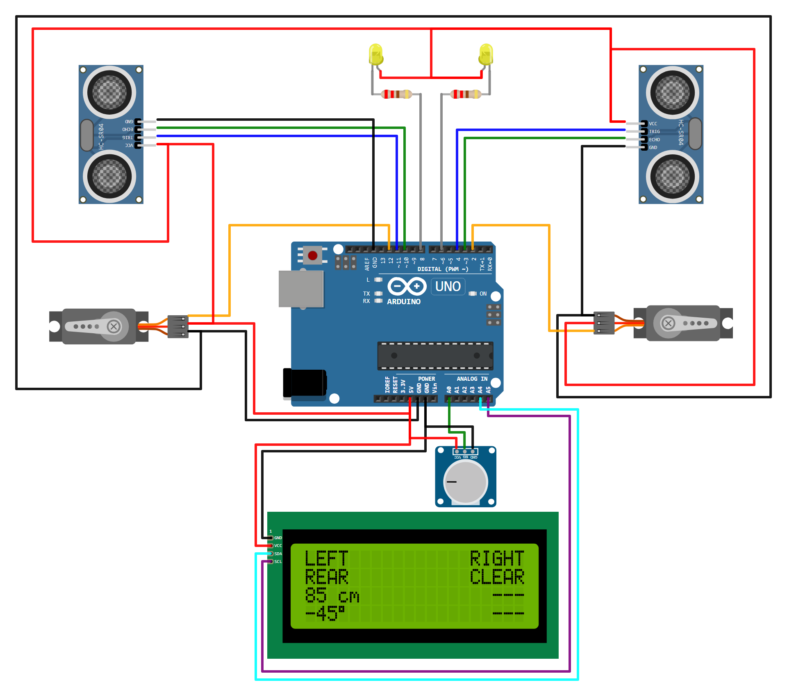
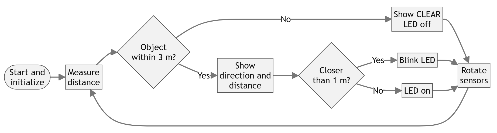

# Vehicle Blind Spot Detection System

Arduino Uno project that sweeps the left and right blind spots with ultrasonic
sensors on servos, and shows the nearest object on each side on an LCD and LEDs.
Submitted for the Peripheral and Interfacing Lab.

## Components
| Part | Qty | Connection |
|---|---|---|
| Arduino Uno | 1 | |
| HC-SR04 ultrasonic sensor | 2 | Left: TRIG D11, ECHO D10. Right: TRIG D4, ECHO D3 |
| SG90 servo motor | 2 | Left PWM D12, Right PWM D2 |
| 20x4 LCD with I2C backpack (0x27) | 1 | SDA A4, SCL A5 |
| 10k potentiometer | 1 | Wiper to A0 (sweep speed) |
| Yellow LED + 220 Ω resistor | 2 each | 5V → LED → resistor → D8 (left), D6 (right) |

## Circuit diagram

## Setup

## How it works

## How to run
### Wokwi (browser)
1. Go to https://wokwi.com and start a new **Arduino Uno** project.
2. Paste `BlindSpotDetection.ino` into `sketch.ino`.
3. Replace the contents of the `diagram.json` tab with this folder's `diagram.json`.
4. Add the `LiquidCrystal I2C` library in the **Library Manager**.
5. Press **Play**.

### VS Code
1. Install the **Wokwi Simulator** extension and get a free license
   (F1 → `Wokwi: Request a New License`).
2. Compile:
   `arduino-cli compile --fqbn arduino:avr:uno --output-dir build .`
3. Open `diagram.json` (or F1 → `Wokwi: Start Simulator`).
